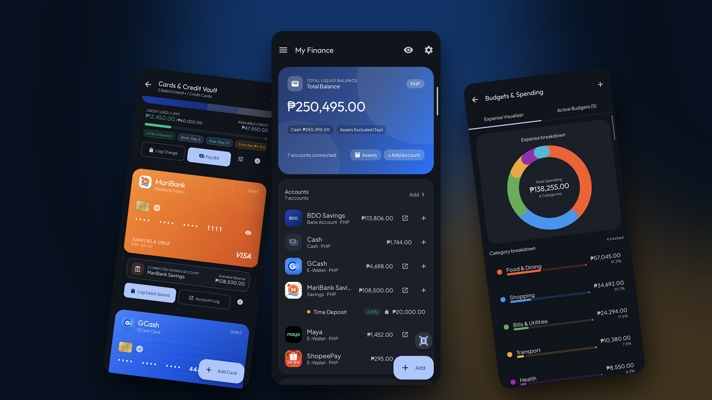
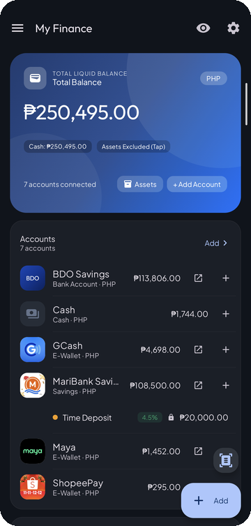
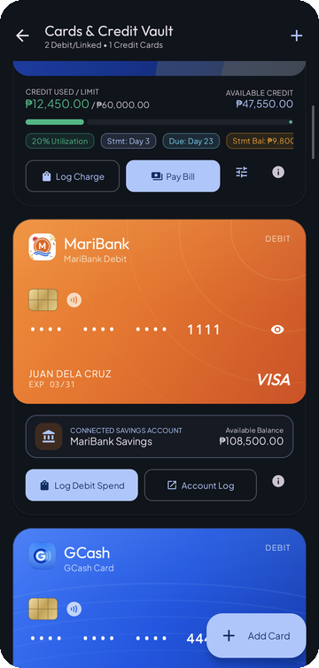
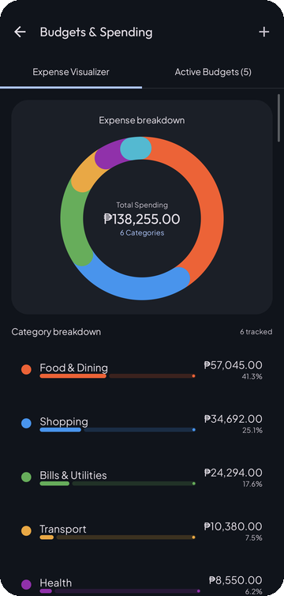
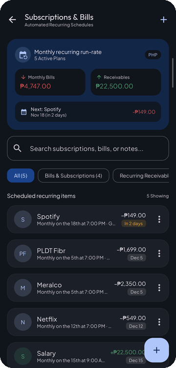
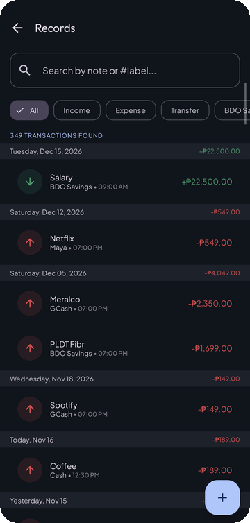
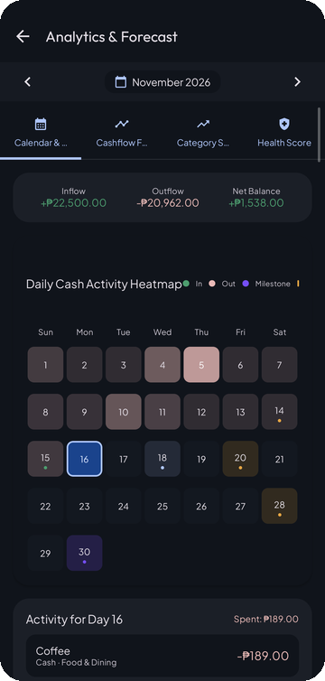
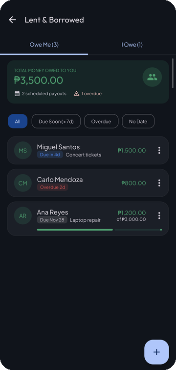
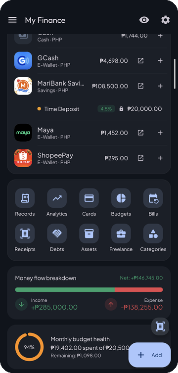

<div align="center">


# My Finance

**Your money, in one place. A local-first personal finance app for Android, with an optional web app.**

[](https://github.com/Rohan-Reyes/Freefinance/releases/latest)
[](https://github.com/Rohan-Reyes/Freefinance/releases/latest)
[](https://developer.android.com/jetpack/compose)
[](LICENSE)

[**Download the APK**](https://github.com/Rohan-Reyes/Freefinance/releases/latest) · [Web app](https://budgets.aten-systems.site) · [ATEN Systems](https://aten-systems.site)



</div>

## Why My Finance

- **Local-first.** Everything lives on your phone. No account, no internet, no ads, no trackers.
- **Your banks, recognised.** GCash, Maya, MariBank, GoTyme, BDO, BPI, ShopeePay and more appear with their real app logos and branded card designs.
- **Sync only if you want.** Turn on sync to use the same data in the web app and on other devices, through a server you control.

## Screenshots

<table>
  <tr>
    <td align="center"><br><sub><b>Dashboard</b><br>Net worth and every account</sub></td>
    <td align="center"><br><sub><b>Cards</b><br>Branded debit &amp; credit cards</sub></td>
    <td align="center"><br><sub><b>Budgets</b><br>Where the money goes</sub></td>
    <td align="center"><br><sub><b>Bills</b><br>Recurring bills and income</sub></td>
  </tr>
  <tr>
    <td align="center"><br><sub><b>Records</b><br>Search and filter every entry</sub></td>
    <td align="center"><br><sub><b>Analytics</b><br>Calendar, cash flow, health score</sub></td>
    <td align="center"><br><sub><b>Debts</b><br>Who owes you, who you owe</sub></td>
    <td align="center"><br><sub><b>Shortcuts</b><br>Everything one tap away</sub></td>
  </tr>
</table>

<sub>Screenshots use fictional sample data.</sub>

## Features

| | |
|---|---|
| **Accounts & net worth** | Cash, banks, e-wallets and sub-accounts (time deposits, savings pockets) with interest rates and locks. One-tap launch of your bank's app. |
| **Budgets** | Monthly limits per category with progress and overspend warnings. |
| **Bills & subscriptions** | Recurring bills, salary and allowances with due dates; pay or receive early with one tap. |
| **Cards** | Debit and credit cards with credit used, statement and due days, and freeze status. Card details stay hidden until you unlock them. |
| **Debts & receivables** | Money lent and borrowed, partial payments and expected pay dates. |
| **Analytics** | Spending by category, monthly trends, a 30-day cash-flow forecast and a daily activity calendar. |
| **Receipts** | Snap receipts and attach proof photos to transactions. |
| **More** | Freelance projects and milestones, assets and valuables, planned payouts, multi-currency with custom rates. |
| **Privacy & security** | Fingerprint / PIN app lock, a privacy mask that hides amounts, no analytics. |
| **Widgets** | Net worth, budget burn, monthly trends and quick-add widgets for your home screen. |
| **Backups** | Full JSON backup (including photos and settings) and CSV export; optional Google Drive backup. |

## Install

1. Download **MyFinance-x.y.z.apk** from the [latest release](https://github.com/Rohan-Reyes/Freefinance/releases/latest) on your Android phone.
2. Open it. If asked, allow your browser to install unknown apps.
3. To update later, install the new APK over the old one. Your data stays, and **Settings → Check for updates** tells you when one is out.

## Web app & sync (optional)

The [web app](https://budgets.aten-systems.site) shows the same accounts, budgets, bills and cards on a big screen. To connect your phone, open **Settings → Data & sync → Server sync** and sign in. Changes sync within seconds while the app is open and about every 15 minutes in the background. Accounts are invite-only.

You can run your own sync server: it is a single Node.js file with no dependencies (`server/server.js`, Node 22.13+) that also serves the web app. See [SYNC.md](SYNC.md) for how sync works and how to run it.

## Build from source

Requirements: JDK 17+, Android SDK with `platforms;android-36.1`, and Gradle 9.3.1 (or Android Studio).

```bash
git clone https://github.com/Rohan-Reyes/Freefinance.git
cd Freefinance
# local.properties: sdk.dir=/path/to/Android/Sdk
keytool -genkeypair -keystore debug.keystore -storepass android -alias androiddebugkey \
  -keypass android -keyalg RSA -keysize 2048 -validity 10000 -dname "CN=Android Debug,O=Android,C=US"
gradle assembleRelease        # app/build/outputs/apk/release/app-release.apk
```

Release builds use R8. Without an upload key (`KEYSTORE_PATH`, `STORE_PASSWORD`, `KEY_PASSWORD`) they are signed with `debug.keystore`.

<details>
<summary>Demo build (sample data, used for these screenshots)</summary>

`gradle assembleDemo` builds **My Finance Demo**, which installs next to the real app and loads fictional data on first launch. Regenerate the data with `python tools/make_demo_data.py` and the README images with `python tools/make_readme_images.py <screenshot-dir>`.
</details>

## Project layout

```
app/       Android app (Kotlin, Jetpack Compose, Room)
server/    Sync server + web host (Node.js, no dependencies)
web/       Web app (plain ES modules, no build step)
tools/     Demo data and README image scripts
docs/      README images
```

## License

[MIT](LICENSE). Made by Rohan Reyes · [ATEN Systems](https://aten-systems.site).
